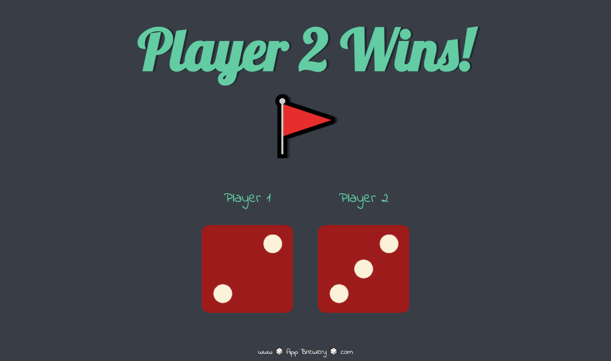

# 🎲 Dice Game

<!-- Replace "screenshot.png" with the actual name of your image file once you upload it to your repository -->

## 📖 About The Project
A simple and interactive 2-player dice rolling game built with HTML, CSS, and Vanilla JavaScript. 

Refresh the page to roll the dice! The script uses JavaScript's `Math.random()` to generate a number between 1 and 6 for both players, manipulates the DOM to update the dice images, and instantly declares the winner at the top of the screen.

## 🚀 Live Demo
[Play the Dice Game Here](https://battleshopventureswaqas-blip.github.io/Dice-Game/)

## 🛠️ Built With
* HTML5
* CSS3
* JavaScript (DOM Manipulation)

## 📫 Let's Connect
Muhammad Waqas Siddique - [LinkedIn]( https://www.linkedin.com/in/muhammad-waqas-siddique-9538213b7 )
